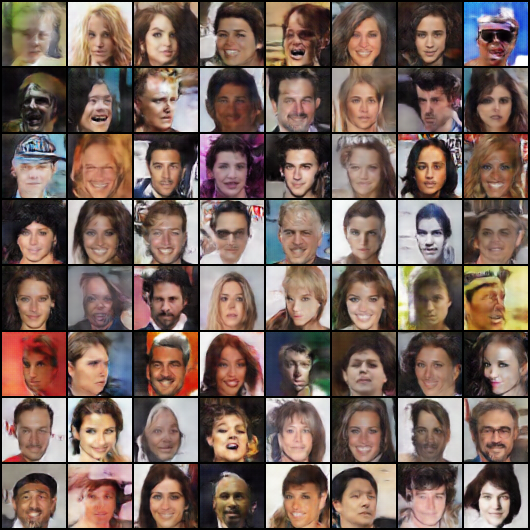
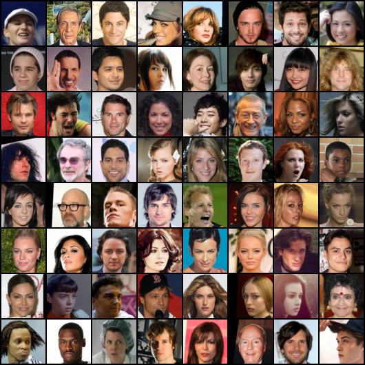
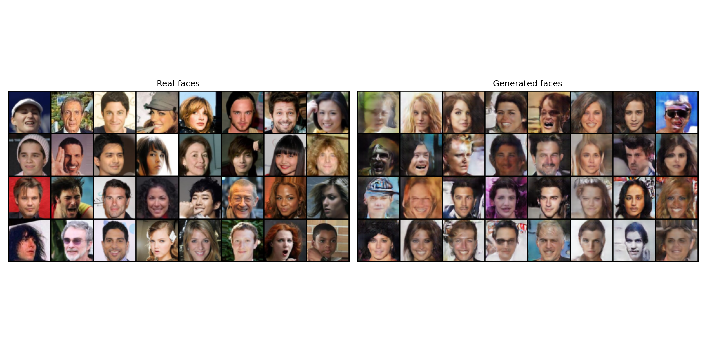
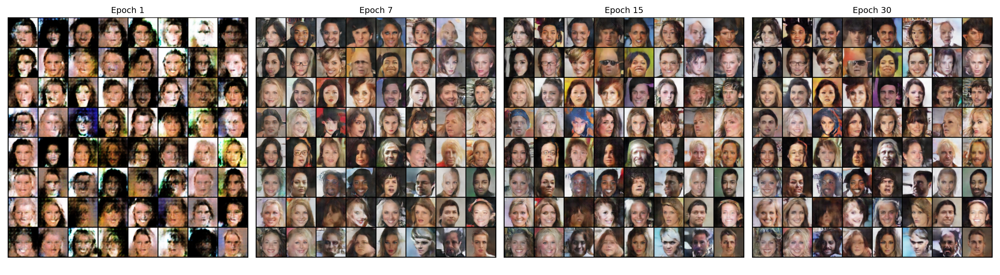
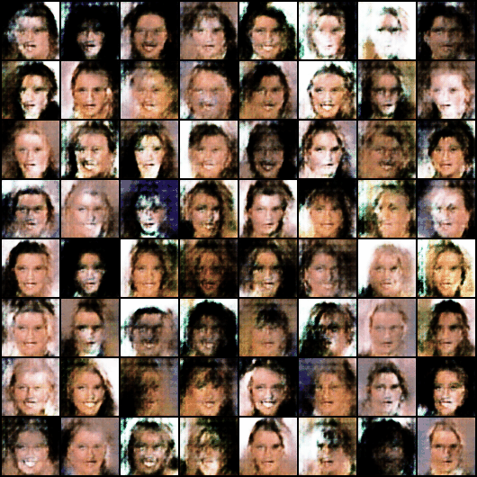
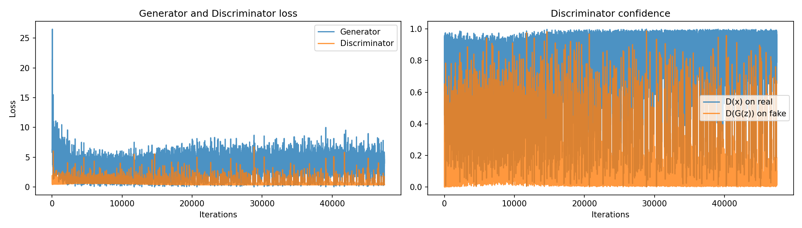

# 🧑‍🎨 Realistic Human Face Generation using GAN


A **Deep Convolutional GAN (DCGAN)** built from scratch in PyTorch that generates realistic synthetic human face images from random noise. A **Generator** learns to create 64×64 faces while a **Discriminator** learns to tell real faces from fake ones, and both improve by competing against each other. The model was trained on **202,599 CelebA face images**.

---

## 🌐 Links

- 📓 **Training notebook on Kaggle:** [realistic-face-generation-gan](https://www.kaggle.com/code/abdelazizelshourbgy/realistic-face-generation-gan)

## 📸 Results at a glance

<p align="center">
  
</p>
<p align="center"><i>64 faces generated from random noise after 30 epochs. None of these people exist.</i></p>

---

## ✨ Features

- Generates new, diverse human faces from random latent vectors
- Generator and Discriminator implemented from scratch (no pre-trained weights)
- Full preprocessing pipeline: crop, resize, normalize
- Losses and Discriminator confidence monitored during training
- Generated samples saved after every epoch from the **same fixed noise**, so progress can be compared fairly over time
- Bonus: latent space interpolation (smooth morphing between two generated faces)

## 🗂️ Dataset

[CelebFaces Attributes (CelebA) Dataset](https://www.kaggle.com/datasets/jessicali9530/celeba-dataset) by jessicali9530 on Kaggle. Please check the dataset page for its license and terms of use.

- **202,599** face images in total (all of them used for training)
- Only the images are used. No labels are needed for a GAN



*Real faces from the dataset after preprocessing.*

## 🧪 Method

**Preprocessing**

| Step | Details |
|---|---|
| Crop | Center crop to 160×160 to remove most of the background |
| Resize | Scale to 64×64 |
| Normalize | Pixel values scaled to [-1, 1] to match the Generator's `Tanh` output |

**Architecture (DCGAN)**

| Model | Details |
|---|---|
| **Generator** (3,576,704 parameters) | Latent vector (100) → 5 × ConvTranspose2d (feature maps 512 → 256 → 128 → 64 → 3) with BatchNorm + ReLU → `Tanh` → 3×64×64 image |
| **Discriminator** (2,765,568 parameters) | 3×64×64 image → 4 × Conv2d (64 → 128 → 256 → 512) with BatchNorm + LeakyReLU(0.2) → Conv2d → `Sigmoid` → probability that the image is real |

**Training setup**

| Setting | Value |
|---|---|
| Loss | Binary cross-entropy |
| Optimizer | Adam (lr = 2e-4, beta1 = 0.5) for both models |
| Batch size | 128 (1,582 iterations per epoch, about 47,460 in total) |
| Epochs | 30 |
| Latent vector size | 100 |
| Weight initialization | Normal(0, 0.02) |
| Label smoothing | Real label = 0.9 |
| Seed | 42 |

The two models play a minimax game: the **Discriminator** maximizes `log D(x) + log(1 - D(G(z)))` and the **Generator** maximizes `log D(G(z))`.

---

## 📊 Results

### Real vs generated faces



### Progress over training

The same fixed noise vectors are fed to the Generator at different epochs, so the images show how the same "seeds" improve over time.



<p align="center">
  
</p>

- **Early epochs** produce blurry, colored blobs.
- **Later epochs** show clear face structure: eyes, nose, mouth, hair, and varied backgrounds and expressions.

### Loss curves



- The **Generator loss** starts very high (about 25) and drops quickly, then stays roughly between 3 and 7 for the rest of training.
- The **Discriminator loss** stays roughly between 0.5 and 1.5.
- The Discriminator is slightly stronger than the Generator: it scores real images around 0.9 and fake images close to 0. This is common in DCGAN training. Training did not diverge, and the loss never collapsed to zero.
- In a GAN the loss is **not** a direct measure of image quality, so the generated images themselves are the main evidence of how well the model works.

### Latent space interpolation

Moving smoothly between two random noise vectors produces a smooth morph between two faces, which shows the Generator learned a meaningful latent space instead of memorizing images.


### Observations

- Faces are diverse in gender, age, head pose, lighting and expression, and there are no signs of **mode collapse** (the model does not repeat the same face).
- Facial features are generally in the right places, though some samples are distorted (asymmetric faces, odd mouths and teeth, blurry hats and accessories).
- Quality is limited by the small 64×64 resolution and the simple DCGAN architecture.

---

## 📁 Project structure

```
face-gan-project/
├── Realistic_Face_Generation_GAN.ipynb   # full notebook: data, models, training, evaluation
├── requirements.txt
├── assets/                               # result images
│   ├── real_faces.png
│   ├── final_generated_faces.png
│   ├── real_vs_generated.png
│   ├── progress_comparison.png
│   ├── training_progress.gif
│   ├── loss_curves.png
│   └── interpolation.png
├── LICENSE
└── README.md
```

The trained weights (`generator.pth` and `discriminator.pth`) are produced by the notebook and saved in `/kaggle/working/output` on Kaggle.

## 🚀 Run it

### On Kaggle (recommended)

1. Open the [notebook](https://www.kaggle.com/code/abdelazizelshourbgy/realistic-face-generation-gan) and click **Copy & Edit**.
2. Make sure the **CelebA Dataset** is added under `Input`.
3. Turn on a **GPU**: `Settings > Accelerator`.
4. Press **Run All**.

For a quick test, set `EPOCHS = 3` and `MAX_IMAGES = 20000` in the configuration cell. Training time depends on the GPU assigned to the session. The full 30-epoch run on the whole dataset took several hours in the Kaggle commit run for this project.

### Locally

```bash
git clone https://github.com/AbdelazizElshourbgy-ui/realistic-face-generation-gan.git
cd realistic-face-generation-gan

python -m venv venv
venv\Scripts\activate        # Windows
# source venv/bin/activate   # macOS / Linux

pip install -r requirements.txt
jupyter notebook Realistic_Face_Generation_GAN.ipynb
```

Download CelebA and set `DATA_DIR` in the notebook to the folder containing the images. A CUDA GPU is strongly recommended.

## ⚠️ Limitations

- Low resolution (64×64), so fine details are lost.
- Some generated faces are distorted, and accessories and backgrounds can look blurry.
- The model was trained once with default hyperparameters (no hyperparameter search), so results can vary between runs.
- Evaluation is visual only. No quantitative metric such as FID was computed.
- CelebA contains celebrity photos, so the generated faces reflect the distribution and biases of that dataset.
- Realistic synthetic faces can be misused (for example for fake profiles or deepfakes). This project is for learning and research only.

## 🔮 Future work

- Higher resolution (128×128 and above)
- More stable training with WGAN-GP or Spectral Normalization
- Conditional GAN to control attributes (smile, glasses, hair color)
- StyleGAN-based generation
- Quantitative evaluation with FID and Inception Score

## 🛠️ Tech stack

Python · PyTorch · torchvision · NumPy · Matplotlib · Pillow · Kaggle

## 👤 Author

**Abdelaziz Elshourbgy**

GitHub: [@AbdelazizElshourbgy-ui](https://github.com/AbdelazizElshourbgy-ui) · LinkedIn: [Abdelaziz Elshourbgy](https://www.linkedin.com/in/abdelaziz-elshourbgy-b126a83a2/)

## 📄 License

Code released under the [MIT License](LICENSE). The dataset belongs to its original authors; see its Kaggle page for the license.
